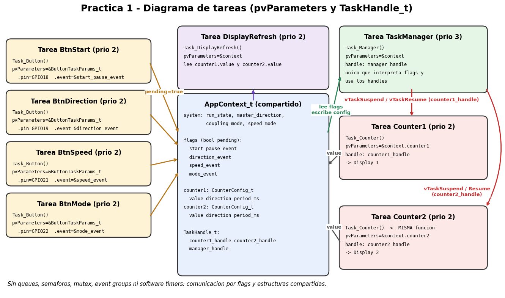

# Práctica 1 – Evidencias

**Materia:** Sistemas Embebidos en Tiempo Real
**Equipo:** _[Integrante 1]_, _[Integrante 2]_, _[Integrante 3]_ &nbsp;← **completar nombres**

## 1. Diagrama de tareas



| Tarea | Función | `pvParameters` | `TaskHandle_t` |
|---|---|---|---|
| Counter1 | `counter_task` | `&context.counter1` (`counter_config_t*`) | `counter1_handle` |
| Counter2 | `counter_task` | `&context.counter2` (`counter_config_t*`) | `counter2_handle` |
| BtnStart / BtnDirection / BtnSpeed / BtnMode | `button_task` | `button_task_params_t*` (pin + evento) | – |
| DisplayRefresh | `display_refresh_task` | `&context` (`app_context_t*`) | – |
| TaskManager | `task_manager` | `&context` (`app_context_t*`) | `manager_handle` |

## 2. Captura / log UART

> **Pendiente:** pegar aquí la captura real del monitor serie (`pio device monitor`, 115200 baud) mientras
> pruebas el hardware. No se incluye una captura inventada. El formato esperado de las líneas es:

```
I (xxx) TASK_MANAGER: STATE=RUNNING
I (xxx) TASK_MANAGER: Counter1 state=<n> Counter2 state=<n>
I (xxx) TASK_MANAGER: DIR=DOWN
I (xxx) TASK_MANAGER: SPEED=FAST
I (xxx) TASK_MANAGER: MODE=SAME
I (xxx) TASK_MANAGER: STATE=PAUSED
```

`<n>` es el valor de `eTaskGetState()`: 0 = Running, 1 = Ready, 2 = Blocked, 3 = Suspended.
Al pasar a PAUSED se espera `state=3` en ambos contadores; en RUNNING, `2` (esperando en `vTaskDelay`).
Para la evidencia conviene mostrar un ciclo completo: RUNNING → DIR → SPEED → MODE → PAUSED → RUNNING.

## 3. Cuestionario

**1. ¿Por qué Counter1 y Counter2 pueden ejecutar la misma función `counter_task()` y comportarse diferente?**
Porque el código de una tarea es solo la función; lo que la distingue es su pila y el parámetro que recibe. Cada instancia se crea con `xTaskCreate` y un `pvParameters` distinto (`&counter1` o `&counter2`), así cada una trabaja sobre su propia estructura (valor, dirección, periodo).

**2. ¿Qué información recibe cada tarea mediante `pvParameters`?**
Los contadores reciben un `counter_config_t*` (valor, dirección, periodo, display). Cada tarea de botón recibe un `button_task_params_t*` con el pin y el puntero al evento que debe publicar. DisplayRefresh y TaskManager reciben el `app_context_t*` completo.

**3. ¿Qué representa un `TaskHandle_t` y por qué el Task Manager necesita conservarlo?**
Es la referencia (identificador) que FreeRTOS devuelve al crear una tarea. Sin ella no se puede indicar sobre qué tarea actuar; el Manager la necesita para `vTaskSuspend()` / `vTaskResume()` de Counter1 y Counter2 y para consultar `eTaskGetState()`.

**4. ¿Qué diferencia existe entre BLOCKED y SUSPENDED en esta práctica?**
Un contador en marcha pasa casi todo el tiempo en BLOCKED: espera en `vTaskDelay()` y el kernel lo despierta solo cuando vence el tiempo. SUSPENDED es un estado al que solo se entra y sale por `vTaskSuspend()`/`vTaskResume()`; ningún timeout lo despierta. Es lo que usa el Manager para la pausa.

**5. ¿Qué ocurre con `vTaskDelay()` cuando una tarea es suspendida?**
La tarea sale de la lista de espera y queda en SUSPENDED; el tiempo restante del retardo se descarta. Al reanudarla vuelve a READY y continúa justo después del `vTaskDelay()`, sin esperar lo que faltaba. En este código eso significa que el contador da un paso casi inmediatamente al reanudar.

**6. ¿Qué ventaja aporta `enum` frente a constantes enteras para representar estados?**
Nombres con significado (`SYSTEM_RUNNING` en vez de `1`), un conjunto cerrado de valores, menos números "mágicos" y avisos del compilador (por ejemplo `switch` incompleto). En C los `enum` son menos estrictos que `enum class` de C++, pero igual mejoran legibilidad y mantenimiento.

**7. ¿Qué responsabilidad tiene el contador BCD y cuál el display?**
`counter.c` (`bcd_counter_t`, `counter_step`) solo sabe contar 0–9 con envoltura, sin tocar hardware ni FreeRTOS, por lo que se puede probar aparte. `display.c` solo sabe convertir un dígito en segmentos y encender el display correcto (multiplexado con GPIO); no sabe contar.

**8. ¿Por qué `volatile` no resuelve por sí solo los problemas de concurrencia?**
`volatile` obliga al compilador a leer/escribir la memoria cada vez, pero no hace las operaciones atómicas ni garantiza el orden o la coherencia entre varios campos. Ejemplo: `align_counters_for_same()` escribe dos valores en dos instrucciones; un contador podría leer un estado a medias, o `counter_task` podría sobrescribir un valor que el Manager acaba de ajustar.

**9. ¿Qué cambiaría en el diseño cuando posteriormente se permitan queues o semáforos?**
Los botones enviarían sus eventos al Manager por una queue (en vez de flags consultados cada 10 ms), el Manager se bloquearía esperando eventos sin sondeo, un mutex protegería el contexto compartido, la pausa podría hacerse con semáforo/event group y los periodos con software timers.

**10. Si ambas tareas tienen la misma prioridad, ¿cómo interviene el scheduler de FreeRTOS?**
Las tareas READY de igual prioridad se reparten el procesador por *round-robin* con rebanadas de tiempo de un tick. Además, como el ESP32 tiene dos núcleos y las tareas no están fijadas a uno, dos tareas pueden ejecutarse realmente en paralelo, cada una en su núcleo.

## 4. Conclusión técnica individual

_[Integrante 1 – nombre]:_ _[Escribir aquí 4–6 renglones con tu propia experiencia: qué costó, qué errores del código base encontraste, cómo probaste el hardware.]_

_[Integrante 2 – nombre]:_ _[…]_

_[Integrante 3 – nombre]:_ _[…]_

## 5. Reflexión

- **Qué resolvió `pvParameters`:** permitió reutilizar una sola función de tarea para dos contadores y cuatro botones. Cada instancia recibe sus propios datos, sin variables globales ni tareas duplicadas.
- **Qué resolvió `TaskHandle_t`:** dio al Task Manager control centralizado sobre Counter1 y Counter2: pausar y reanudar ambos a la vez con `vTaskSuspend()`/`vTaskResume()` conservando su valor, y consultar su estado.
- **Riesgo al no usar mecanismos de sincronización:** los flags y estructuras compartidas se acceden desde varias tareas (posiblemente en núcleos distintos) sin protección. `volatile` no basta: puede haber condiciones de carrera (valores a medias, un evento de botón perdido si se pulsa justo cuando el Manager lo consume, un valor sobrescrito por otra tarea). Funciona en la práctica porque las escrituras son simples y espaciadas en el tiempo, pero no está garantizado; la solución correcta es usar queues y mutex.
