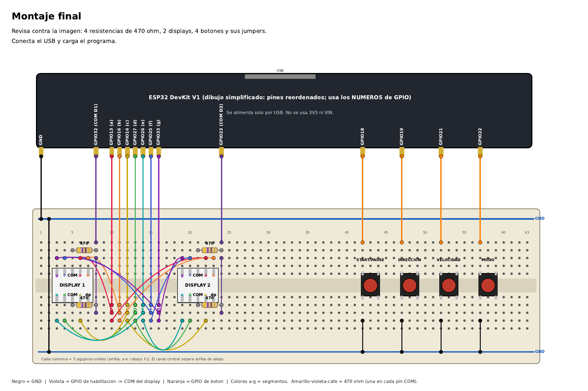

# Guía de conexiones – Práctica 1 (Doble contador BCD)

ESP32 **DevKit V1** · 2 displays de 7 segmentos **cátodo común** · 4 push buttons · **sin transistores**.
No necesita fuente externa (todo sale de la ESP32 por USB).

> **PDF ilustrado paso a paso (protoboard de 63 columnas):** [Guia_Protoboard_63.pdf](Guia_Protoboard_63.pdf)



## 1. Material

| Cant. | Componente |
|---|---|
| 1 | ESP32 DevKit V1 |
| 2 | Display 7 segmentos 1 dígito, cátodo común |
| 4 | Resistencia **470 Ω** (amarillo‑violeta‑café): **una en cada pin COM** de cada display (2 por display) |
| 4 | Push button (sin resistencia: se usa el pull‑up interno) |
| — | Protoboard de 63 columnas y jumpers |

## 2. Cómo funciona

- Los 7 segmentos (a‑g) de **ambos** displays van en paralelo a los mismos 7 GPIO, **sin resistencia por segmento**.
- Cada display tiene **dos pines COM** (arriba y abajo, unidos por dentro). Los dos van, **cada uno por una resistencia de 470 Ω**, al **mismo GPIO** (32 para el Display 1, 23 para el Display 2). **Nunca a GND**: si el COM está fijo a tierra el display no se puede apagar y ambos mostrarían lo mismo. Con el GPIO en **0** el display enciende; en **1** se apaga (`DISPLAY_EN_ACTIVE_LEVEL 0` en `app_config.h`).
- `display_refresh_task()` alterna cada 10 ms entre Display 1 y 2 (multiplexado).

**¿Funcionan así las 470 Ω? Sí.** Los dos pines COM del mismo display son el mismo nodo, así que sus dos 470 Ω quedan en paralelo (≈ 235 Ω). Toda la corriente del display pasa por ahí: ≈ (3.3 V − ~2 V) / 235 Ω ≈ **6 mA en total**, repartidos entre los segmentos encendidos. Es seguro para los pines (bajo 12 mA). Efectos: brillo moderado, y un dígito con pocos segmentos ("1") se ve más brillante que uno con muchos ("8"). (Con una sola 470 en un COM también funcionaría, con ~3 mA y menos brillo.)

## 3. Tabla de pines (coincide con `include/app_config.h`)

| Señal | GPIO | Va a |
|---|---|---|
| Segmento a | 13 | directo al pin **a** de Display 1 **y** Display 2 |
| Segmento b | 16 | directo al pin **b** de ambos |
| Segmento c | 14 | directo al pin **c** de ambos |
| Segmento d | 27 | directo al pin **d** de ambos |
| Segmento e | 26 | directo al pin **e** de ambos |
| Segmento f | 25 | directo al pin **f** de ambos |
| Segmento g | 33 | directo al pin **g** de ambos |
| COM Display 1 | 32 | 470 Ω → COM superior y 470 Ω → COM inferior del Display 1 |
| COM Display 2 | 23 | 470 Ω → COM superior y 470 Ω → COM inferior del Display 2 |
| Botón Start/Pause | 18 | otro lado del botón a GND |
| Botón Dirección | 19 | otro lado a GND |
| Botón Velocidad | 21 | otro lado a GND |
| Botón Modo | 22 | otro lado a GND |

> El segmento **b** usa GPIO16 y no GPIO12: el GPIO12 es pin de *strapping* del ESP32 y puede impedir el arranque (adaptación de GPIO permitida por la práctica).

## 4. Pinout del display (vista frontal, punto decimal abajo a la derecha)

```
 Fila superior (izq→der):   10=g   9=f   8=COM   7=a   6=b
 Fila inferior (izq→der):    1=e   2=d   3=COM   4=c   5=dp
```
El punto (dp) no se conecta. Los dos pines COM están unidos internamente: usa solo uno.

## 5. Armado (columnas de la protoboard de 63)

1. GND de la ESP32 → riel GND superior; puente del riel superior al inferior (col. 2).
2. Displays cruzando el canal: Display 1 en cols **3‑7**, Display 2 en cols **19‑23**.
3. GPIO de segmentos (13, 16, 14, 27, 26, 25, 33) a la fila inferior de las cols 10‑16.
4. De cada columna 10‑16, dos jumpers al mismo segmento de Display 1 y de Display 2.
5. Display 1: una 470 Ω del COM superior (col. 5) a col. 8 y otra del COM inferior (col. 5) a col. 8 (abajo); puente corto que une col. 8 arriba con col. 8 abajo; jumper GPIO32 → col. 8. Display 2: igual con col. 21 → col. 24 y GPIO23.
6. Botones cruzando el canal (cols 42‑44, 47‑49, 52‑54, 57‑59): arriba al GPIO (18, 19, 21, 22), abajo al riel GND inferior.
7. Compilar y cargar: `pio run -t upload`, monitor: `pio device monitor`.

## 6. Problemas comunes

| Síntoma | Causa probable |
|---|---|
| Nada enciende o los dos muestran lo mismo | Las 470 van a GND en lugar de a GPIO32/23 (deben ir al GPIO), o falta GND común, o el COM no llega al GPIO, o `DISPLAY_EN_ACTIVE_LEVEL` no es 0 |
| Los dos displays muestran lo mismo | Los COM deben ir a GPIO distintos |
| Un segmento apagado en ambos | Jumper de esa línea suelto |
| Un segmento apagado en un solo display | Cable de puente de ese display |
| Muy tenue | Normal con multiplexado; usa 220 Ω en lugar de 470 Ω si quieres más brillo |
| Un botón cuenta varias veces | Mal contacto (antirrebote de 20 ms en `BUTTON_PERIOD_MS`) |
